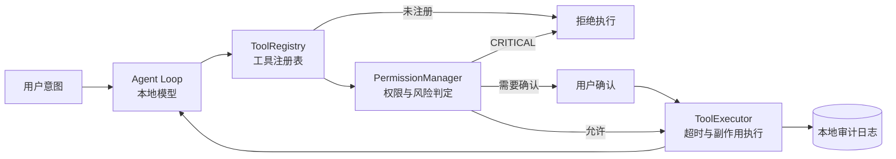

<div align="center">

# PC Guardian AI

### 把 Windows 电脑变成一台安全、可审计、真正能执行任务的本地 AI 工作站

用自然语言操作电脑。对话、记忆、知识库与自动化规则默认留在本机；每一次系统操作都必须经过权限闸门，并留下可追溯记录。

[](LICENSE)
[](#运行要求)
[](https://tauri.app/)
[](https://ollama.com/)
[](#项目状态)

**本地优先 · 权限可控 · 操作可审计 · 模型可替换**

[快速开始](#快速开始) · [核心能力](#核心能力) · [安全设计](#安全设计) · [架构](#系统架构) · [路线图](#路线图)

</div>

---

## 它解决什么问题

普通 AI 助手会回答问题，却很难安全地替你操作电脑。PC Guardian AI 把“理解意图”和“执行动作”彻底分开：

- **LLM 负责规划**，不直接接触系统 API。
- **权限系统负责裁决**，按工具、路径和风险等级决定是否放行。
- **执行器负责动作**，并将结果和审计记录回传给模型。

这让 AI 不只会聊天，还能在边界清晰、结果可验证的前提下完成真实任务。

| 常见桌面助手 | PC Guardian AI |
| --- | --- |
| 模型直接决定并执行动作 | 模型只能提出工具调用请求，执行前必须经过权限闸门 |
| 对话与记忆依赖云端 | 对话、记忆、知识库和规则默认写入本地 SQLite |
| 操作过程难追溯 | 工具调用、风险等级、参数摘要和结果统一留痕 |
| 能做什么取决于提示词 | 221 个能力契约明确声明用途、副作用和验证方式 |
| 模型与服务绑定 | 本地模型、媒体生成端点与服务商均可替换 |

> **隐私边界**：默认推理通过本机 Ollama 完成。只有在你显式配置媒体生成、邮件等联网服务后，对应功能才会访问网络。

## 核心能力

| 能力 | 你可以做什么 | 关键设计 |
| --- | --- | --- |
| **本地 AI 对话** | 使用自然语言拆解并执行桌面任务 | 支持任意 Ollama 实例，默认 `qwen3:8b`，断网可用 |
| **安全工具调用** | 操作文件、系统、浏览器、办公文档与业务工具 | `ToolRegistry → PermissionManager → ToolExecutor` 三层闸门 |
| **记忆与知识库** | 保存长期记忆、导入资料并在对话中检索 | 本地 SQLite 持久化，数据边界清晰 |
| **网页工坊** | 从需求文档生成单文件 HTML，并继续定向修改 | 生成后自动自检，支持版本回退与失败保护 |
| **自动化与工作流** | 运行定时任务、主动规则和多步骤流程 | 任务状态、步骤结果和证据统一入库 |
| **全模态感知（可选）** | 结合屏幕画面与系统声音判断当前上下文 | 独立 sidecar 进程，按需启停，不与主程序强耦合 |
| **语音交互** | 语音输入、长文本稳定播报 | 分句队列、心跳保活、Markdown 清洗 |
| **媒体生成** | 对接图像与视频生成服务 | OpenAI 兼容协议，端点和模型可替换 |
| **多端配对** | 手机扫码接入并复用桌面端能力 | 本地网关与配对码机制 |

## 安全设计

安全不是一个开关，而是 PC Guardian AI 的执行路径。



### 五级风险策略

| 风险等级 | 默认策略 |
| --- | --- |
| `SAFE` / `LOW` | 直接放行 |
| `MEDIUM` | 弹窗确认 |
| `HIGH` | 弹窗 + 二次确认 |
| `CRITICAL` | 禁止执行 |

- 风险等级由工具契约声明，**不由模型临场决定**。
- 白名单按“工具 + 路径 + 风险等级”生效，不是无限授权。
- 文件路径会经过规范化与边界校验，降低路径穿越风险。
- 每次工具调用都会写入审计记录；当前保证为应用层追加式留痕，不等同于密码学防篡改存储。
- LLM 不获得任意 Shell、PowerShell 或 CMD 执行入口。

### 能力契约

每个工具都在 `src-tauri/src/tools/contract.rs` 中声明：

1. 会做什么；
2. 可能产生什么副作用；
3. 如何验证结果。

当前共有 **221 个能力契约、37 个执行器域**。启动时会校验契约覆盖率，新增工具若遗漏契约，会立即暴露在启动日志中。

## 快速开始

### 运行要求

- Windows 10 / 11
- Node.js 18 或更高版本
- Rust 1.77 或更高版本（edition 2021）
- [Ollama](https://ollama.com/) 与至少一个本地模型
- 可选：`ffmpeg`、全模态感知运行时、媒体生成服务凭据

### 1. 准备本地模型

```bash
ollama pull qwen3:8b
```

你也可以使用其他 Ollama 模型，并在应用设置中修改模型名。

### 2. 启动开发版

```bash
git clone https://github.com/Strader9/Helper.git
cd Helper
npm install
npm run tauri dev
```

### 3. 构建 Windows 安装包

```bash
npm run tauri build
```

Tauri 默认生成 NSIS 安装包，安装模式为当前用户。

### 4. 首次配置

打开应用后进入设置页：

1. **模型**：填写 Ollama 地址（默认 `http://localhost:11434`）与模型名，并测试连接。
2. **安全**：按需配置受信任目录和工具白名单。
3. **凭据**：仅在需要邮件或媒体生成时填写对应密钥。

| 服务 | 默认值 |
| --- | --- |
| 前端开发端口 | `1420` |
| 本地网关 | `4769` |
| Ollama | `11434` |
| 全局快捷键 | `Alt + Shift + Space` |

> **凭据提示**：凭据当前存储于本地 SQLite，读取时会掩码显示，但尚未迁移到系统凭据管理器。请勿在当前预览版本中写入生产环境密钥。

## 使用场景

### 本地任务助手

让 Agent 整理文件、提取文档信息、生成内容或串联多个桌面操作。所有动作在执行前都经过权限判定。

### 网页原型生成

导入 PDF、DOCX、Markdown 或 TXT 需求文档，生成可直接预览的单文件 HTML。系统会检查语法、按钮绑定和关键功能缺陷，失败时保留上一版本。

### 自动化与主动任务

创建定时任务、工作流和主动规则，运行记录、步骤结果与证据全部保存在本地。

### 可选的全模态感知

独立感知进程可按频率采集屏幕帧和系统音频，由模型判断当前该监听、响应还是保持安静。该能力默认不启用，并受显存约束。

## 系统架构

```text
React / TypeScript UI
        │ Tauri IPC
        ▼
Rust Agent Runtime
  ├─ Agent Loop + Ollama Client
  ├─ ToolRegistry
  ├─ PermissionManager
  ├─ ToolExecutor
  ├─ Memory / Knowledge / Workflow / Scheduler
  └─ Audit / Evidence / SQLite
        │
        ├─ Windows APIs / Browser / Files / Office
        ├─ Optional cloud services (explicit configuration only)
        └─ Optional multimodal sidecar
```

### 技术栈

| 层 | 选型 |
| --- | --- |
| 前端 | React 18 · TypeScript 5 · Vite 6 · Tailwind CSS 4 · Radix UI |
| 桌面容器 | Tauri 2 · WebView2 |
| 后端 | Rust 2021 · Tokio |
| 存储 | SQLite（`rusqlite` bundled） |
| 本地模型 | Ollama，默认 `qwen3:8b` |
| Windows 能力 | Win32 API · Windows.Media.Ocr |
| 语音 | Web Speech API · Windows OneCore |
| 可选感知 | 独立 sidecar · MiniCPM-o 4.5 |

### 代码结构

```text
Helper/
├── src/                          # React 前端
│   ├── pages/                    # 产品页面
│   ├── components/               # 通用组件
│   ├── contexts/                 # Tauri 适配层
│   ├── services/                 # API 客户端
│   └── lib/                      # TTS 与工具函数
├── src-tauri/src/                # Rust 后端
│   ├── agent/                    # Agent Loop
│   ├── llm/                      # Ollama 客户端
│   ├── tools/                    # Registry / Contract / Executors
│   ├── security/                 # 权限、命令与路径策略
│   ├── memory/ knowledge/        # 记忆与知识库
│   ├── workflow/ scheduler/      # 工作流与定时任务
│   ├── browser/ computer/        # 浏览器与桌面控制
│   ├── monitoring/ evidence/     # 监控与证据
│   └── db/                       # SQLite schema
├── sidecar/                      # 可选感知进程
└── public/                       # 静态资源
```

## 设计原则

1. **本地优先，而不是本地限定**：默认离线工作；联网能力必须显式配置。
2. **先声明能力，再允许执行**：不存在“模型想做什么就做什么”的隐式通道。
3. **高风险操作由用户决定**：确认权属于用户，模型不能替代授权。
4. **失败必须可见**：超时、中止、返修失败都会明确报告，不把半成品伪装成成功。
5. **结果必须可验证**：工具契约不仅描述动作，也描述验证方式。

## 项目状态

> 当前版本：`0.1.0`，处于早期预览阶段，适合开发、测试和架构评估，不建议直接用于生产环境。

| 模块 | 状态 |
| --- | --- |
| Agent Runtime 与工具调用 | 已完成 |
| 权限系统与审计链路 | 已完成 |
| 本地模型对话 | 已完成 |
| 浏览器、GitHub、自动化与通知 | 已完成 |
| 界面体系重构 | 已完成 |
| 全模态感知接入 | 已完成，可选启用 |
| 图像 / 视频生成链路 | 已完成，需自行开通服务商模型 |
| 系统凭据管理器 | 规划中 |

## 已知限制

- 当前主要面向 Windows，语音合成依赖 Windows OneCore。
- 全模态感知与本地对话模型可能争用同一张显卡；显存不足时需二选一运行。
- 扫描版 PDF 的 OCR 流程仍有限制。
- 媒体生成能力依赖用户自行配置并开通兼容服务。
- 部分设置修改后需要重启应用才能完全生效。
- 当前没有稳定版安装包发布流程，优先从源码运行。

## 故障排查

<details>
<summary><strong>点击展开常见问题</strong></summary>

| 现象 | 常见原因 | 处理方式 |
| --- | --- | --- |
| 界面白屏 | 开发版前端未启动 | 使用 `npm run tauri dev`，或先启动 Vite |
| 媒体生成返回 `ModelNotOpen` | 服务商账号未开通模型 | 在服务商控制台开通对应模型 |
| 返回 `InvalidEndpointOrModel.NotFound` | 模型 ID 不完整 | 使用控制台显示的完整模型 ID |
| 感知服务一直未运行 | 原生 worker 或命名管道未就绪 | 先确认 worker 已启动并成功加载模型 |
| 本地对话突然变慢 | 感知进程占用显存 | 关闭感知后重试 |
| 端口被占用 | 上次进程未完整退出 | 结束残留进程后重新启动 |
| 设置修改未生效 | 运行时尚未重新加载 | 重启应用 |

</details>

## 路线图

- [x] 本地 Agent Runtime 与工具调用
- [x] 安全权限闸门与审计记录
- [x] 本地模型对话、浏览器与自动化能力
- [x] 网页工坊与版本回退
- [x] 可选全模态感知接入
- [x] 图像 / 视频生成链路
- [ ] 系统凭据管理器集成
- [ ] 扫描文档 OCR 完整流程
- [ ] 自动化测试、发布签名与稳定版安装包
- [ ] 完整用户文档与贡献指南

## 贡献

项目仍在快速迭代中。提交 Issue 或 Pull Request 前，请尽量说明：

- 问题发生的 Windows 版本与硬件环境；
- 使用的 Ollama 与模型版本；
- 可复现步骤、期望结果与实际结果；
- 是否涉及文件、网络或系统操作权限。

新增工具时，请同步补充能力契约、风险等级和结果验证策略。

## License

本项目采用 [GNU Affero General Public License v3.0](LICENSE)。

你可以使用、修改和分发本项目；分发衍生版本或通过网络提供修改版服务时，需要按照 AGPL-3.0 提供相应源代码。项目界面设计系统与部分前端组件复用了同为 AGPL-3.0 的上游实现，因此衍生作品需要继续遵守相同许可证。

---

<div align="center">

**让 AI 能做事，也让每一次动作都有边界。**

</div>
